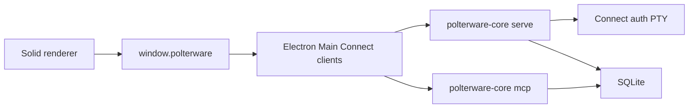
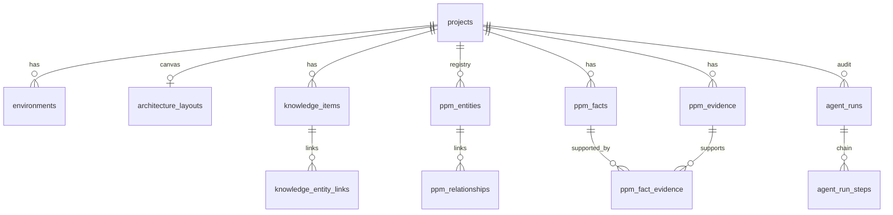
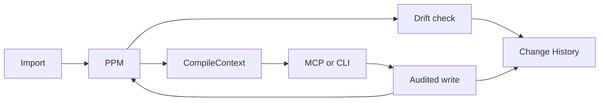

# Local wedge runtime

Status: Describes the implemented local wedge

Authority for behavior: [`docs/spec.md`](../spec.md). This note is the process and persistence map. It is not a second specification. Post-wedge direction (not shipped): [`post-wedge-direction.md`](post-wedge-direction.md). Discussion snapshot: [`docs/ideas/2026-09-24-post-wedge-strategy.md`](../ideas/2026-09-24-post-wedge-strategy.md).

## Shape

The Desktop is an Electron app. Electron Main starts a local Go daemon, `polterware-core`, on loopback. The renderer never talks to the daemon directly. Humans, the CLI, and MCP agents use the same PPM schema and the same SQLite file when they are pointed at the same database. There is no account and no hosted control plane in this runtime.

```text
Desktop / CLI / MCP
        |
        v
polterware-core (Go)
        |
        v
SQLite local.db
```

## Repository layers

| Area | Path | Role |
| --- | --- | --- |
| Desktop | `apps/desktop` | Electron Main, typed preload, Solid renderer |
| Features | `packages/features/*` | Architecture, Knowledge, Resources, Integrations, Settings, Shell, Commander |
| Frontend | `packages/frontend/*` | Design system, state, canvas, platform |
| Contracts | `schemas` → `packages/contracts` and `backend/platform/gen` | Protobuf and Connect clients/handlers |
| Runtimes | `backend/runtimes/core`, `backend/runtimes/cli` | `polterware-core` and `polterware` |
| Compositions | `backend/compositions/local-core`, `backend/compositions/wedge` | Connect server; shared import, compile, drift, audited writes |
| Domains | `backend/domains/*` | PPM, context, drift, agentrun, knowledge, projects, resources |
| Persistence | `backend/providers/sqlite`, `backend/platform/db/sqlite` | Store and versioned migrations |

## Boot

1. Electron Main mints a session token and resolves `userData/local.db` ([`apps/desktop/src/main/core/process-supervisor.ts`](../../../apps/desktop/src/main/core/process-supervisor.ts)).
2. Main spawns `polterware-core` with `-listen 127.0.0.1:0` and `-db`. In development, if the binary is missing, it falls back to `go run ./backend/runtimes/core`.
3. The core opens SQLite, runs migrations, and listens ([`backend/runtimes/core/main.go`](../../../backend/runtimes/core/main.go)). Main reads the listen URL from stderr.
4. Main holds ConnectRPC clients and sends `Authorization: Bearer <token>`. The core rejects any other token.
5. The Solid renderer calls `window.polterware` only. Preload forwards IPC to Main.

`POLTERWARE_CORE_ENDPOINT` and `POLTERWARE_CORE_TOKEN` can point Main at an already running core. Without them, Main first reads `<db dir>/run/core.json`. If a live `standalone` core for the same database exists (for example, one started from the `polterware` TUI), Main attaches to it and leaves it running on quit. See [`cli.md`](cli.md#run-state). The Desktop passes Electron `userData/local.db` (product name Polterware). A core or CLI started on its own defaults to `~/Library/Application Support/polterware/local.db`. They share a model only when `-db` is the same file.

## Process boundary



The renderer has no Node access. Host execution (import, provider CLIs, Connect auth PTY) stays in the core. Provider credentials stay in the OS or CLI credential store, not in SQLite. Residual terminal support exists only for Integrations Connect authentication.

## Persistence

Migration `0010_kill_ops_terminal_nodes.sql` dropped Operations, workflows, schedules, process sessions, ops logs, and Nodes. The wedge tables that remain:



`architecture_layouts.body_json` is the visual source of truth for the canvas. `ppm_entities` and `ppm_relationships` are the typed registry synced from layouts, resources, and environments. Fact truth classes are `declared`, `observed`, `inferred`, and `verified`. Evidence kinds include `file`, `observation`, `test`, `commit`, and `other`.

## Wedge loop

B1–B9 are implemented. Rules live in the linked notes; this section only shows the path.

| Slice | What runs | Note |
| --- | --- | --- |
| B1 Facts and evidence | `ppm_facts`, `ppm_evidence`, `ppm_fact_evidence` | Provenance on the model |
| B2 Import | `ImportProjectSources` / `polterware scan` | [`deterministic-import.md`](deterministic-import.md) |
| B3 Compiler | `CompileContext` | [`context-compiler.md`](context-compiler.md) |
| B4 MCP reads | `context.get`, `entity.get`, `evidence.get`, `drift.check` | [`stable-mcp-reads.md`](stable-mcp-reads.md) |
| B5 Drift | Narrow checker; findings, not overwrite | [`narrow-drift-checker.md`](narrow-drift-checker.md) |
| B6 AgentRun | `context → task → change → evidence → drift` | [`minimal-agent-run-audit.md`](minimal-agent-run-audit.md) |
| B7 Audited writes | MCP tools require `summary`, `rationale`, `agent_run_id` | [`audited-mcp-writes.md`](audited-mcp-writes.md) |
| B8 CLI | `init`, `scan`, `context`, `drift` | [`cli.md`](cli.md) |
| B9 History | Agents → History for `human` and `agent` | [`unified-change-history.md`](unified-change-history.md) |

Desktop semantic Knowledge and PPM writes use `wedge.ExecuteAuditedWrite` in [`backend/compositions/wedge/audited.go`](../../../backend/compositions/wedge/audited.go). A human write with an empty `agent_run_id` starts and completes a `human` run. An agent write must already have an open run.



## Three clients, one model

| Client | Entry | Auth | Store |
| --- | --- | --- | --- |
| Desktop | Connect through Electron Main | Session bearer | `userData/local.db` |
| CLI `polterware` | In-process store | None (local process) | `-db`, same default family as the core |
| MCP | `polterware-core mcp` on stdio | Local process | Same store the core opened |

CLI and MCP call `backend/compositions/wedge`. They do not keep a second project model.

## Outside this runtime

Cloud, the Web App, hosted Context Oracle, sync, and Jev or LLM calls are not part of this process. See [`post-wedge-direction.md`](post-wedge-direction.md) and [ADR 0005](../adr/0005-post-wedge-cloud-and-enrichment-boundary.md).
