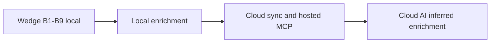
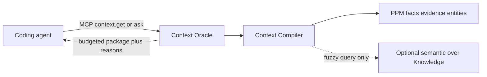

# Post-wedge product direction

Status: Direction only — not shipped

Authority: [ADR 0005](../adr/0005-post-wedge-cloud-and-enrichment-boundary.md), [`docs/product-vision.md`](../product-vision.md) v3, [ADR 0004](../adr/0004-product-positioning-and-wedge.md). Do not treat items here as implemented in [`docs/spec.md`](../spec.md).

## Context

Wedge validation B1–B9 is complete for local validation ([`wedge-validation-sequence.md`](wedge-validation-sequence.md)). This note captures the 2026-09-24 strategy discussion: what to build next locally, what Cloud may charge for, how agents get cheap context without a RAG-as-truth oracle, and how Git/code and Cloud AI fit the PPM.



## Differentiation (do not dilute)

The durable product combo is not memory, canvas-as-thesis, or ops:

1. Truth classes with evidence: `declared` / `observed` / `inferred` / `verified`
2. Budgeted `context.get` with machine `reasons` and evidence refs
3. Audited mutations (`summary`, `rationale`, AgentRun)
4. Drift as findings, never automatic overwrite
5. Unified Change History for human and agent

Marketing GraphRAG, Mem0-style memory, or “chat over the repo” as the category contradicts ADR 0004 and ADR 0005.

## Local enrichment backlog

Ordered direction. Each item needs its own accepted specification before implementation.

| Order | Item | Intent |
| --- | --- | --- |
| 1 | Git metadata import | HEAD, branch, recent commits as `evidence` (`kind = commit`); stamp observed facts with revision |
| 2 | Broader deterministic import + scan reconcile | Expand MVP source families; prune/reconcile so re-scan matches drift honesty |
| 3 | Provider observations (read path) | Connected CLIs/APIs → evidence; not a control plane |
| 4 | Architecture as Code export | Versionable YAML/JSON/Markdown projection of relevant PPM; no proprietary DSL |
| 5 | Context profiles + secret filtering | Intent-shaped packages; strip secrets before MCP/Desktop packages |
| 6 | Verify-fact flow | Human path from declared/observed → `verified` with actor |
| 7 | Richer Drift UI | Findings open entity/ADR/fact in the shared DetailPanel |
| 8 | Structured SDD | Requirements/plan/tasks/evidence as graph, beyond five Markdown kinds |
| 9 | Local Change Gates | Optional human review before durable truth (single-user rehearsal for Cloud gates) |

Related shipped foundations: [`deterministic-import.md`](deterministic-import.md), [`context-compiler.md`](context-compiler.md), [`narrow-drift-checker.md`](narrow-drift-checker.md).

## Cloud v1 and v2

Cloud is an addition after the local model is dense enough to sync. Capabilities compose into the Desktop; authorization stays server-side ([`deployment-model.md`](deployment-model.md), [`hosted-ui-porting.md`](hosted-ui-porting.md)).

### Cloud v1 (minimum paid continuity)

| Feature | Pain |
| --- | --- |
| Project sync (PPM + Knowledge + history) | Model differs across machines / teammates |
| Managed backup / restore | Disk loss or machine change |
| Org + project membership | Who may read/write the model |
| Hosted MCP (project-scoped token) | CI or teammate agents without Desktop open |
| Shared Change History | Team-visible justified changes |

### Cloud v2 (collaboration and gates)

| Feature | Pain |
| --- | --- |
| Teams + ACL | Enterprise read/write/approve |
| Hosted Change Gates | Inbox for promoting inferred or high-blast mutations |
| Web App review | Read context, drift, history without Desktop; org admin |
| Sync conflict policy | Explicit resolve; no silent magical merge |

Web App owns organization, team, access, usage, plans, and billing administration. Desktop may show context and deep-link ([ADR 0002](../adr/0002-single-desktop-and-cloud-connection.md)).

### Cloud must not

- Ship an AI memory product or parallel vector SoT
- Provision VPS/AWS Nodes or remote execution
- Gate local wedge features behind a subscription
- Host customer applications as the product

## Context Oracle

**Intent:** Coding agents (Cursor, Codex, Claude Code, and similar) must not burn tokens reading every repo and every doc. They ask for a small, provenance-aware package.

**Name:** Context Oracle means **budgeted context over the PPM** (local `context.get` today; hosted multi-project later). It does **not** mean “RAG is the source of truth.”



### Multi-repo

Cross-repo answers come from **linked entities and evidence** across projects in the shared model (Cloud federation later; manual links acceptable earlier). Example: agent in `orders` asks how billing integrates → resolve `billing` entity, OpenAPI evidence, relationships, accepted ADRs — without cloning the other repository.

### Cost

| Approach | Token effect |
| --- | --- |
| Dump architecture / many files into the agent | Expensive |
| Compiler package with `token_budget` (often no LLM) | Cheap for the coding agent |
| Retrieve + generate prose on every ask | Extra cost; use only when explain is required |

Prefer returning the structured package; optional LLM explain is secondary.

## Git versus code

Specs, PPM entities, manifests, OpenAPI, ADRs, and Git metadata are usually enough for architecture and integration questions.

| Need | Prefer |
| --- | --- |
| Integration / decision / ownership | PPM + Knowledge + import evidence |
| “What changed?” / which revision | Git metadata and commit evidence |
| “Where is this implemented?” | On-demand path/excerpt when evidence is missing |

**Git v1 (direction):** HEAD, branch, remote, dirty/clean; recent commits → evidence; attach revision to observed import facts.

**Out of scope:** Embed the full source tree; codebase-wide RAG as ingest; put entire trees into `context.get`.

## Cloud AI stack (after sync)

Enrichment only; truth stays the PPM.

| Capability | Role |
| --- | --- |
| `architecture.review` | Typed findings (`inferred`) anchored to entities/ADRs/drift |
| `architecture.suggest` | Improvement proposals; accept/reject → gate or human verify |
| `architecture.summarize` | Structured summary package; optional prose |
| Chat | Explains findings/packages; not the store |
| TypeSafe Jev | Closed typed judgments (severity, route, rank) behind Cloud |
| Cheap LLM | Prose and chat only |

```text
Deterministic PPM and compiler
        ↓
Inferred AI proposals (Jev + LLM in Cloud)
        ↓
Human or Change Gate
        ↓
declared / verified truth
        ↓
context.get for all agents
```

Do not put `TYPESAFE_API_KEY` or vendor LLM keys in Desktop, renderer, or the `polterware` binary. Local must work offline.

## Out of scope / kill reinforcement

| Area | Destiny |
| --- | --- |
| AI memory / Mem0 positioning | Kill as product |
| RAG or embeddings as SoT | Kill as product |
| Nodes / VPS-AWS fleets / remote execution | Removed; do not reintroduce ([`kill-ops-terminal-nodes.md`](kill-ops-terminal-nodes.md)) |
| Operations / Terminal-as-product | Removed; do not reintroduce |
| GraphRAG as marketed category | Kill |
| Chat as Cloud headline | Secondary UX only |

## Pointers

- Wedge status: [`wedge-validation-sequence.md`](wedge-validation-sequence.md)
- Import: [`deterministic-import.md`](deterministic-import.md)
- Compiler: [`context-compiler.md`](context-compiler.md)
- Deployment / capabilities: [`deployment-model.md`](deployment-model.md)
- Hosted UI porting: [`hosted-ui-porting.md`](hosted-ui-porting.md)
- Decisions: [ADR 0005](../adr/0005-post-wedge-cloud-and-enrichment-boundary.md)
- Implemented runtime: [`local-wedge-runtime.md`](local-wedge-runtime.md)
- Discussion snapshot: [`docs/ideas/2026-09-24-post-wedge-strategy.md`](../ideas/2026-09-24-post-wedge-strategy.md)
