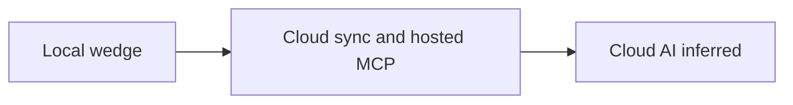

# Post-wedge strategy snapshot

Status: Idea snapshot — not a specification

Date: 2026-09-24

Source: strategy discussion after wedge B1–B9 (Cloud worth, local enrichment, Context Oracle versus RAG, Git versus source, Cloud AI).

## Boundary already accepted

The boundary from this discussion was promoted. Do not treat this note as a second decision.

- [ADR 0005](../adr/0005-post-wedge-cloud-and-enrichment-boundary.md) records Cloud, anti-features, context, AI enrichment, Git ingest, and sequence.
- [`docs/architecture/post-wedge-direction.md`](../architecture/post-wedge-direction.md) is the living backlog.
- [`docs/architecture/local-wedge-runtime.md`](../architecture/local-wedge-runtime.md) describes the local system that already runs.
- Jev and bring-your-own LLM key detail stays in [2026-09-28-jev-and-llm-api-keys.md](2026-09-28-jev-and-llm-api-keys.md).

Shipped behavior remains [`docs/spec.md`](../spec.md).

## Why Cloud does not pay yet

The reduced category is project context and change intelligence, not hosting, memory, or a control plane. Local SQLite already owns the PPM. Cloud only earns a subscription when a team feels a pain the laptop cannot solve.

| Pain | Cloud idea |
| --- | --- |
| The model differs across machines or teammates | Project sync (PPM, Knowledge, history) |
| Disk loss or a new machine | Managed backup and restore |
| Who may read or write the model | Organization and project membership |
| CI or a teammate agent without the Desktop open | Hosted MCP, project-scoped |
| The team needs one justified change feed | Shared Change History |

Later, still on the same model: Teams and ACL, hosted Change Gates, Web App review. Organization admin stays on the Web App. The Desktop composes from server capabilities and does not unlock local features behind an account.

## Anti-ideas

| Idea | Why it stays out |
| --- | --- |
| AI memory as the product | Commodity. ADR 0004 already kills Mem0-style positioning. |
| Nodes, VPS, or AWS fleets | Ops control plane. Nodes stay removed. |
| Provider consoles and workflows | Observe providers. Do not operate them. |
| RAG or embeddings as the source of truth | Retrieval is not provenance. The PPM is the model. |
| Chat as the Cloud headline | Chat may explain a package. It is not the store. |

## Local enrichment menu

Ordered preference from the discussion. Each item still needs its own spec before implementation. The same order is the backlog in the post-wedge architecture note.

| Order | Idea |
| --- | --- |
| 1 | Git metadata import (HEAD, branch, commits as evidence, revision on observed facts) |
| 2 | Wider deterministic import and scan reconcile |
| 3 | Provider observations on the read path |
| 4 | Architecture as Code export (Markdown, JSON, or YAML; no proprietary DSL) |
| 5 | Context profiles and secret filtering |
| 6 | Human verify-fact flow |
| 7 | Richer Drift UI in the shared detail panel |
| 8 | Structured spec-driven development |
| 9 | Local Change Gates |

The differentiator to protect while adding these: truth classes with evidence, budgeted `context.get` with reasons, audited writes, drift as findings, and one change history for human and agent.

## Context Oracle

Intent: a coding agent should not spend a large token budget reading every repository and every document. It asks; Polterware returns a small package.

The name means budgeted context over the PPM. It does not mean a vector index is the truth.

| Step | Role |
| --- | --- |
| Resolve the entity and one-hop links | Exact, cheap |
| Attach facts, ADRs, and evidence paths | Provenance |
| Pack under `token_budget` with machine reasons | What the agent should read |
| Semantic retrieval | Only when the query is fuzzy and the graph is not enough |
| LLM prose | Optional explain. Not required for a cheap tool call. |

Cross-repo questions (for example how `orders` integrates with `billing`) are answered from linked entities and evidence, not by cloning the other tree into the prompt.

## Git versus code

Specs, entities, manifests, OpenAPI, ADRs, and Git metadata answer most architecture and integration questions. Source text is the last hop.

| Need | Prefer |
| --- | --- |
| Integration, decision, ownership | PPM and Knowledge |
| What changed, and at which revision | Git metadata and commit evidence |
| Where this is implemented | One path or excerpt, on demand, when evidence is missing |

Out of this idea: embedding the source tree, or putting whole trees into `context.get`.

## Cloud AI, later

After sync and hosted MCP, enrichment stays `inferred` until a person or a Change Gate promotes it.

| Capability | Output |
| --- | --- |
| `architecture.review` | Typed findings anchored to entities, ADRs, and drift |
| `architecture.suggest` | Proposals to accept or reject |
| `architecture.summarize` | A structured summary; prose is optional |
| Chat | Explains findings and packages |

TypeSafe Jev supplies closed judgments (rank, route, severity). A cheap LLM writes prose. API keys stay in `polterware/cloud`. The Desktop, the renderer, and `polterware-core` stay offline-capable. `pnpm jev` remains a development aid.

## RAG and GraphRAG evaluation (2026-09-28)

Source: follow-up discussion on RAG for Polterware and the cost of GraphRAG on a local Desktop. This is an exploratory assessment, not a change to [ADR 0005](../adr/0005-post-wedge-cloud-and-enrichment-boundary.md), the [product vision](../product-vision.md), or shipped behavior in [`spec.md`](../spec.md).

### Purpose and fit

Retrieval-augmented generation (RAG) selects external evidence before a model produces an answer or an agent acts. It has an indexing phase (discover sources, split them into retrievable units, record metadata, optionally compute embeddings) and a query phase (retrieve, rank, pack a bounded context, then optionally ask a model to explain it). Embeddings represent semantic similarity; they do not establish truth. RAG helps with current or private project knowledge and avoids sending an entire repository to an agent. It is useful for questions about decisions, conventions, ownership, dependencies, and where to inspect an implementation. A known ADR path is still better read directly.

The earlier discussion suggested a general Knowledge Layer over docs, code, infrastructure, specs, runbooks, and Git, with PostgreSQL + pgvector as a possible vector store and `POST /context` as an example interface. Those were sketches, not implementation choices. The current Desktop is SQLite-backed and already exposes the [Context Compiler](../architecture/context-compiler.md) through MCP `context.get`. Its PPM entities, typed relationships, facts, evidence, Knowledge links, exact search, and FTS are the starting point. A second database, a new Context API, and full source-tree indexing are not required by this idea and conflict with the current wedge boundary if treated as defaults.

A concrete task such as “add rate limiting to the API” should first resolve the relevant component and its accepted ADRs, constraints, linked facts, and file evidence. The package can identify the gateway, existing middleware, and relevant paths, with reasons and citations. The agent can inspect source code at those paths when needed. The package should never claim that a suggested middleware is correct solely because it ranked highly.

### Retrieval path proposed for evaluation

1. Resolve exact project/entity identifiers and accepted PPM relationships; include linked facts, decisions, and evidence.
2. Search Knowledge and registered source metadata lexically (FTS/BM25 or exact identifiers), with filters for project, source kind, status, revision, and authority. Code symbols and paths often need lexical matching.
3. Only if measured queries miss relevant material, try optional semantic retrieval over a bounded, approved corpus such as Knowledge. Merge candidates with exact and lexical results; do not promote similarity to authority.
4. Use one-hop PPM traversal for dependency or impact questions. This is graph traversal over an existing product model, not necessarily GraphRAG.
5. Rank by task relevance, authority, freshness, and provenance; deduplicate overlapping excerpts; pack under `token_budget` with stable reasons, source paths, revision, and explicit omissions. A reranker is optional and should earn its CPU, memory, latency, and token cost in a measured comparison.

The proposed Project Context Compiler is a way to think about this output: a typed, versioned package of applicable decisions, constraints, relevant entities/files, conflicts, and evidence gaps. It extends the existing compiler concept, not a second canonical project state. Rules and permissions remain explicit contracts and policy decisions; retrieved prose cannot grant an agent authority. Retrieval can improve grounding and make context selection more repeatable, but neither retrieval nor an LLM makes agent behavior deterministic. Validation and audited changes remain separate steps.

More retrieved text is not automatically better. Context pollution occurs when stale, redundant, or weakly related passages obscure the relevant evidence; long prompts can also bury an important constraint. Token efficiency therefore means measuring relevance per token, preferring a few cited excerpts and paths, disclosing omissions, and letting the agent request the full source progressively. Ranking must favor an applicable accepted decision over a semantically similar obsolete note.

### Indexing, provenance, and freshness

For documentation, split by headings or meaningful sections and keep the path, range, revision, and status. For code, an AST-aware parser could index symbols (module, class, function, method) without cutting a function mid-body, but only for targeted files or on-demand inspection under the current boundary. AST parsing adds language-specific maintenance and parser failure cases. It should not silently become codebase-wide ingest. Manifests, OpenAPI, Terraform, and other structured sources should prefer deterministic extraction over embedding their raw text.

Every candidate must retain source identity, path or entity ID, content hash or Git revision where available, observed time, extraction method, and truth class (`declared`, `observed`, `inferred`, or `verified`). The PPM and underlying files remain authoritative within their stated scope; an embedding, generated summary, or extracted graph edge is a derived index. If a README conflicts with running configuration or an ADR, expose both with a drift/conflict signal and a request for verification. Never collapse contradictory sources into a high-confidence sentence without evidence. This distinction matters especially for private or stale project material.

Incremental maintenance should detect changed, deleted, and renamed sources, invalidate their derived chunks/embeddings/edges, and replace only affected items. Record the indexed revision and reject or label stale hits when the working tree has moved. Graph summaries may depend on many upstream nodes, so a small source change can invalidate a wider community report. An update queue should coalesce rapid edits, run outside the critical UI path, be cancellable, and let the existing exact/FTS compiler continue to work while optional indexes catch up. These are design criteria, not shipped behavior.

### GraphRAG: cost on a local Desktop

GraphRAG in the fuller research-system sense extracts entities and relationships from text, detects communities, generates community reports, and embeds multiple artifacts for search. That can help with corpus-wide synthesis and multi-hop questions that exact links cannot answer. It is materially heavier than querying the PPM's typed edges. The [GraphRAG indexing architecture](https://microsoft.github.io/graphrag/index/architecture/) and [method comparison](https://microsoft.github.io/graphrag/index/methods/) document those additional stages; the latter describes its standard extraction as more expensive than its faster, noisier alternative. Costs below are qualitative expectations, not Polterware benchmarks.

| Resource or operation | Full GraphRAG pressure on a local Desktop | Lighter Polterware path |
| --- | --- | --- |
| CPU | Parsing, entity extraction, clustering, report generation, and vector queries can compete with the editor and core. Local model inference is the largest variable. | Reuse deterministic import, SQLite FTS, and bounded PPM traversal; schedule optional work in the background. |
| RAM | A resident embedding or generative model, graph processing, and temporary batches add peak memory beyond the app. | Keep no mandatory model resident; bound batches and traversal depth. |
| Storage | Chunks, vectors, graph edges, community reports, caches, and model weights duplicate parts of the source corpus. | Store compact facts, evidence references, and small optional indexes; avoid full-body copies where paths suffice. |
| Initial indexing | Corpus-wide extraction and summarization may require many model calls or long local inference. | Index the MVP source set first; inspect code or enrich Knowledge only where measured need exists. |
| Embeddings | Each source change can require recomputation; local inference consumes compute and a model download, while a remote API adds network, money, and data-boundary questions. | Keep embeddings optional, scoped, cached by content hash, and subordinate to exact/lexical matches. |
| Database/graph | A separate graph or vector service adds packaging, migrations, lifecycle, and failure modes. | Use existing SQLite tables and typed PPM relationships; add no service unless measurements justify it. |
| Query latency | Multi-stage expansion, reranking, and model-generated reports delay answers, especially after cold start. | Return a bounded structured package without mandatory generation; progressive disclosure for deeper questions. |
| Incremental update | Deletes, renames, changed edges, and community summaries need dependency-aware invalidation. | Reconcile by source/revision; update affected facts and evidence; defer optional derived indexes. |

The Microsoft implementation has an [incremental update command](https://microsoft.github.io/graphrag/cli/), so incremental indexing is possible in principle. It does not remove Polterware's need to handle freshness, invalidation, and locally acceptable resource use. Its [custom graph workflow](https://microsoft.github.io/graphrag/index/byog/) also shows that existing graph data can be reused; using the PPM directly is the simpler first experiment. SQLite's [FTS5](https://www.sqlite.org/fts5.html) already offers full-text ranking without a vector service.

### Decision gate

Do not adopt GraphRAG as a product category or make it a mandatory local dependency. First compare representative questions against the existing `context.get`: exact entity lookup, architectural constraints, dependency impact, conflicting evidence, and a fuzzy knowledge query. Record answer evidence, missed relevant sources, false positives, context tokens, p50/p95 latency, cold and warm CPU/RAM, disk growth, initial indexing time, and edit-to-freshness delay on small and large projects. Compare (a) current exact/FTS + PPM edges, (b) bounded semantic Knowledge retrieval, and only then (c) graph-derived enrichment. A graph or embedding stage is justified only if it improves a concrete missed-query class within an acceptable local resource budget, preserves source-level citations, and degrades safely to the existing compiler. No fixed hardware requirement or cost number is asserted without a Polterware benchmark.

## What this note does not authorize

Presence here is not approval to build Cloud, widen import, add MCP tools, or call an LLM from the Desktop. Follow ADR 0005 and a later specification.
