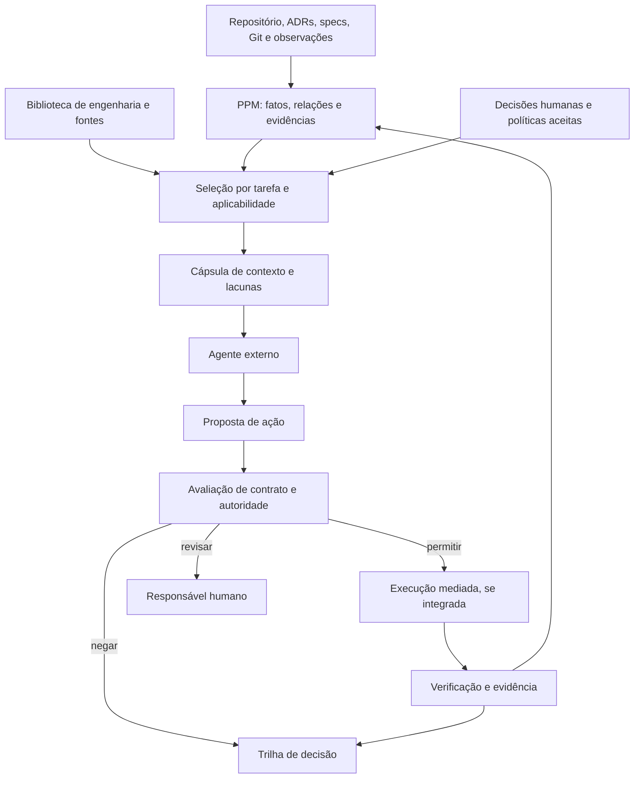

# Polterware como infraestrutura de contexto e governança de engenharia

Status: Ideia de pesquisa e produto — não é especificação, decisão arquitetural aceita nem funcionalidade entregue

Data: 2026-09-28

Origem: discussão sobre reprodutibilidade comportamental de coding agents, conhecimento de engenharia e decisões humanas.

## Tese em discussão

Agentes de programação podem produzir soluções úteis, mas variam entre execuções, reconstruindo de maneiras diferentes o projeto, suas decisões e seus limites. A hipótese é que um modelo verificável do projeto, contexto seletivo, decisões com responsáveis explícitos e verificações externas ao agente reduzam mudanças inesperadas sem sacrificar excessivamente a conclusão das tarefas.

Uma formulação exploratória é **engineering control plane para desenvolvimento assistido por IA**: uma camada que informa o agente sobre o projeto, registra decisões e evidências, e, onde houver integração capaz de mediar efeitos, avalia propostas de ação. É uma hipótese de posicionamento, **não** a categoria pública aprovada. A direção vigente é *Project Context & Change Intelligence for AI Coding* em [`product-vision.md`](../product-vision.md) e [ADR 0004](../adr/0004-product-positioning-and-wedge.md). O uso de “control plane” aqui significa governança de trabalho de engenharia; não reabre Operations, Terminal ou Nodes como produto.

## O que a discussão propõe

1. **Entendimento compartilhado:** o Polterware Project Model (PPM) relaciona intenção declarada, estado observado, inferências, verificações, decisões e evidências com proveniência.
2. **Contexto para a tarefa:** uma cápsula curta seleciona fatos, trechos, ADRs, lacunas e caminhos de fonte relevantes sob um orçamento de tokens. O documento completo continua no repositório e é lido sob demanda.
3. **Conhecimento de engenharia:** uma biblioteca versionada relaciona fontes, princípios, condições de aplicabilidade e verificações. Nenhum paper vira política automaticamente.
4. **Autoridade explícita:** humanos escolhem arquitetura, método de trabalho e estratégia de testes; invariantes e decisões já aceitas limitam a atuação do agente; detalhes locais podem ser delegados.
5. **Comportamento observável:** contratos de projeto e de tarefa, ações tipadas e estados de execução são uma hipótese para mediar ações, verificar efeitos e registrar trilhas auditáveis.

As notas [runtime comportamental](2026-09-28-behavioral-runtime.md), [conhecimento e evidência](2026-09-28-engineering-knowledge.md), [decisões humanas](2026-09-28-decision-ownership.md) e [pesquisa e validação](2026-09-28-research-and-product-validation.md) detalham essas frentes.

## Arquitetura conceitual

Esta é uma arquitetura **proposta**. O wedge local já implementa partes do PPM, importação determinística, compilação de contexto, leituras MCP, drift e histórico auditável; a extensão para protocolos universais de ações, gateway e execução mediada não está aprovada aqui. Consulte [`spec.md`](../spec.md) para o comportamento entregue e [`context-compiler.md`](../architecture/context-compiler.md) para o contexto atual.

## Fronteiras necessárias

- **Fonte de verdade:** fatos e decisões têm classe, origem, revisão, ambiente, data e responsável; a recuperação textual ajuda a localizar evidência, mas não transforma um resultado de busca em verdade.
- **Lacuna é resultado válido:** quando faltam requisitos de consistência, escala, risco ou responsabilidade, apresentar a lacuna e solicitar a decisão adequada. Não preencher a lacuna com preferência do modelo.
- **Conhecimento não é ordem:** literatura e padrões ajudam a construir alternativas e verificações; a aplicabilidade depende do projeto e da decisão humana.
- **Mediação tem limite técnico:** se Cursor, Codex ou outra ferramenta mantiverem shell e escrita direta fora do Polterware, o produto pode observar ou apontar drift, mas não garantir que toda ação foi bloqueada antes do efeito. Promessas de enforcement dependem de integração que realmente controle o caminho de execução.
- **Adoção incremental:** a pesquisa deve medir se a seleção de contexto e a governança agregam valor antes de ampliar o produto para um runtime de execução.

## Estado das afirmações

| Afirmação | Classe nesta nota |
| --- | --- |
| O posicionamento atual é Project Context & Change Intelligence | Decisão de produto vigente, documentada fora de `docs/ideas` |
| Polterware pode evoluir para governança de engenharia entre agentes | Hipótese de produto |
| Contratos externos podem reduzir variância comportamental | Hipótese de pesquisa |
| Proveniência e decisão arquitetural são conceitos existentes na literatura | Referência conceitual, não validação do produto |
| Um gateway universal para agentes funcionará com baixo atrito | Questão aberta a validar |

## Próximo passo de decisão

Validar separadamente valor para usuários, efeito técnico e custo de integração. Uma eventual promoção requer atualização explícita de visão, especificação e ADRs aplicáveis; a presença desta nota não autoriza novas superfícies, ferramentas MCP ou capacidades de execução.
