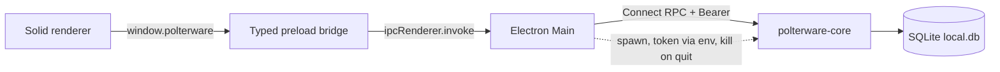

# Local SQLite workspace

Status: Superseded intermediate specification

Current product spec: [`../../../spec.md`](../../../spec.md)

> The out-of-scope list below records this migration's original boundary. Later accepted work added local execution, PTYs, CLI detection, and live log behavior.

The Desktop reads and writes project data through the local Go core. Visual fixtures are no longer the production source of truth.

## Goal

Operators can open Polterware, inspect a demonstration project, and persist changes in SQLite. The renderer never talks to the database or to Connect RPC.

## Architecture

- Connect clients live in Electron Main.
- The session token is passed as `POLTERWARE_SESSION_TOKEN`. It is never an argv flag.
- The core listens on `127.0.0.1:0` and prints the endpoint on stderr.
- `POLTERWARE_CORE_ENDPOINT` and `POLTERWARE_CORE_TOKEN` skip spawn for an already running core.

## Data

The SQLite baseline is `0001_first_version.sql`. There is no compatibility with earlier databases. Local `local.db` files must be deleted after this change.

Seeded demonstration project:

- id: `proj-polter`
- environments: production, staging, development
- architecture layout and views
- resources, nodes, processes
- knowledge documents and runbooks
- workflows, runs, schedules
- integration connections, resources, and sync runs

`MaintenanceService.ResetLocalStore` deletes project data and reseeds when the store is empty.

Derived UI fields (counts, formatted timestamps, `isCurrent`) are computed in the renderer. They are not stored as columns.

## Out of scope

- Operation execution
- Real PTYs
- CLI binary detection
- Live log streaming (`SubscribeLogs` still reads stored chunks and closes)
- Hosted or shared workspaces
- Real provider tokens
